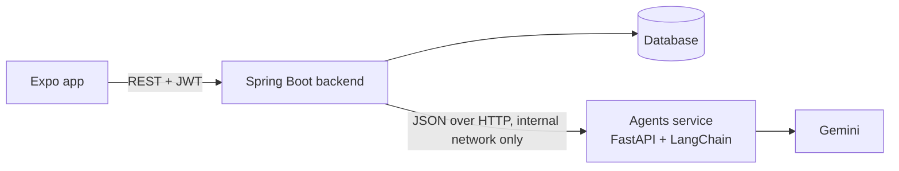

# AI Agents: Architecture and Build Plan

How the four agents and the speech tool are built, how they connect to the Spring
Boot backend, and what to build next. Based on `develop` at `402f23e`, the screen
reference (frames 01–30) and the Figma file.

The exact request and response JSON of every endpoint is in
[`agents-api-contract.md`](agents-api-contract.md). How to run the service is in
[`../agents/README.md`](../agents/README.md).

## 1. Where the agents sit

- The app never calls the agents service (rule 3 of `api-contract.md`).
- The backend owns every piece of data: users, lessons, the text Tika extracts from
  the teacher's files, placement attempts, mistakes, chat history.
- The agents service is **stateless**. Each request carries the context it needs
  (teacher text, level, recent mistakes, chat history) and each response is JSON
  that the backend stores.

Stateless keeps one database with one owner, lets the agents service restart or
scale freely, and makes the agents testable without a database. It also fits what
the backend already does: `GeneratedSlideDeck` and `GeneratedExerciseSet` cache
generated content per `Lesson.contentVersion`, so an agent runs once per lesson
version, not once per student.

## 2. Rules every agent follows

1. **Code decides anything with one right answer.** Placement points and level,
   the next reply mode, word diffs, letter scrambles and typed-answer
   normalisation are plain Python. The LLM never counts points or grades a
   multiple-choice answer.
2. **The LLM fills a schema.** Each agent asks Gemini for structured output whose
   JSON schema is a Pydantic model.
3. **Every output is checked.** Code checks what the schema cannot express: the
   answer is one of the options, a fill-in-the-blank has exactly one blank, a
   correction quotes words the student really wrote. On failure the agent sends
   the problems back to the model once. If the second answer still fails, the
   endpoint returns `502` and the backend keeps its current fallback.
4. **Answer keys stay on the server.** The backend sends the app only `index`,
   `prompt`, `options` and `audioText` of a practice item, never
   `correctAnswer`, `acceptedAnswers` or `explanation` before the student answers.
5. **EN / FR / AR.** Text the student can switch language on (slide hints,
   explanations, the level summary, chat corrections) comes back as
   `{ "en", "fr", "ar" }`. The toggle is instant and one cached deck serves every
   student.
6. **Untrusted text is data.** Teacher files and student messages go into the
   prompt inside delimiters. The character ignores instructions written in
   student messages.
7. **Model settings.** One shared `gemini-3.5-flash-lite` client (`GEMINI_MODEL`),
   30 s timeout, 2 retries. Temperature is left at Gemini 3's default, as Google
   recommends for Gemini 3 models.

## 3. The agents

| Agent | Screens | Endpoint | Input from the backend | Replaces in the backend |
|---|---|---|---|---|
| 1 Placement | 08–11 | `POST /api/agents/placement/evaluate` | question bank with answer key and CEFR level, student answers, unit titles per level | scoring in `PlacementService.submitAttempt` |
| 2 Slides | 14–17 | `POST /api/agents/slides/generate` | lesson title and level, Vocabulary, Grammar, Pronunciation text | `LessonStudyService.buildSlidesJson` |
| 3 Practice | 20–27 | `POST /api/agents/practice/questions`, `POST /api/agents/practice/check-answer`, `POST /api/agents/writing/feedback` | lesson text, Listening transcripts, Writing description, recent mistakes | `GeneratedContentService.buildExercises`, `LessonStudyService.buildWritingFeedback` |
| 4 Character | 28–30 | `POST /api/agents/character/episode`, `POST /api/agents/character/reply` | Other file and description, lesson text, chosen role, chat history | the open `/api/agents/stream` call in `practice/character.tsx` |
| Speech tool | 21, 29 | `POST /api/agents/speech/transcribe` | recorded audio | nothing yet |

### Agent 1: placement test

- The question bank stays in the database (`PlacementQuestion`). Each question
  needs a CEFR `level` and, for the mistakes list, a `focus`.
  [`placement-test-bank.json`](placement-test-bank.json) is a replacement seed:
  15 questions, 3 per level from A1 to C1.
- **Scoring rule.** For each level, count the correct answers. The student is
  placed at the first level where they get fewer than 2 of 3 right, or C1 if they
  pass every level. With four options, passing a level by guessing has a 16 %
  chance, so placing at the *first* failed level stops lucky guesses on the B2 and
  C1 questions from moving a beginner up.
- Gemini writes the two-sentence summary shown on frame 11 ("You know the first
  words and sentences. Next you will learn…") from the per-level results and the
  unit titles of the assigned level. If Gemini fails, a fixed summary per level is
  returned instead, so onboarding never blocks on the model.

### Agent 2: course slides

- Input is the text Tika already extracts from the Vocabulary, Grammar and
  Pronunciation files, plus the lesson title and level.
- Output is a deck of 3 to `maxSlides` slides. Each slide has `kind`
  (`intro`, `vocabulary`, `grammar`, `pronunciation`, `recap`), `title`,
  `bullets`, `example`, `hint` in three languages and an optional `miniExercise`
  (`prompt`, `options`, `answer`). This is the shape the slide viewer
  (frames 16–17) renders.
- Checks: every material the teacher uploaded gets at least one slide, every
  mini-exercise answer is one of its options, bullets stay short.
- **Teachers' "any file to slides" idea.** Tika already reads PDF, DOCX and TXT.
  Scanned PDFs and photos have no text layer; Gemini can read them directly, which
  is the next step for that feature. The same slide JSON can also be exported to
  PPTX for teachers who want to present in class.

### Agent 3: practice

Every game item is an atomic question with a single correct answer. That lets the
backend's existing answer check (case-insensitive equality in
`PracticeSessionService.submitAnswer`) and mistake saving work for every game,
including the Figma games.

| `gameType` | Student sees | Item shape |
|---|---|---|
| `QUIZ` | question and 4 answers | `options` has 4 entries, `correctAnswer` is one of them |
| `FILL_BLANK` | sentence with `____` and word chips | prompt has exactly one `____`, 3–4 `options` |
| `TRUE_FALSE` | statement, True or False (Quick quiz) | `options` is `["True", "False"]` |
| `WORD_MATCH`, `MEMORY_CARDS` | board of pairs | one pair per item: `prompt` is the word, `correctAnswer` its meaning, `options` empty |
| `WORD_SCRAMBLE` | letter tiles and a clue | `options` are the letters, shuffled by code |
| `SPELLING_BEE` | hears a word, types it | `audioText` is spoken by the app's text-to-speech |
| `LISTENING_QUIZ` | audio player and a question (frame 27) | 3–4 `options`, built from the Listening 1 transcript |
| `SPEAKING` | a prompt to answer aloud | `correctAnswer` is a model answer, graded by `check-answer` |

- **Questions change, the game stays.** Generate a pool of 10–15 items per game
  per lesson version, cache it, and let each session draw 3 (MVP) or 10–15 items
  from it. New questions every session, one model call per lesson version.
  `excludePrompts` asks for a fresh pool when one runs out.
- **Mistakes drive re-asking.** Every item carries a `focus`, a short learning
  point such as `present simple: he/she/it + -s`. The backend saves it with the
  mistake and sends the student's recent mistakes with the next request. Any focus
  missed twice or more becomes a review target, and about a third of the new items
  practise it.
- **Typed and spoken answers.** `check-answer` first normalises both sides (case,
  punctuation, curly quotes, contractions such as `I'm`). Only when they still
  differ does Gemini judge whether the meaning and grammar are right.
- **Writing.** `writing/feedback` returns a headline, a comment, the corrected
  text, and one entry per mistake (`sentence`, `wrong`, `right`, `category`,
  `explanation`, `focus`), which is the content of frame 25. The strike-through
  view is a word diff computed by code from the student's text and the corrected
  text. Each mistake can go straight into `StudentMistake`.
- Listening uses the Listening 1 transcript. If a teacher uploads only audio, the
  backend can transcribe it once with the speech tool and store the transcript.

### Agent 4: character chat

- **Episode.** Built from the teacher's Other file and description, the lesson's
  vocabulary and grammar, and the student's choice of character (sister, cousin,
  friend, partner, boss…) and optional scenario. Returns the intro card of
  frame 28: title, setting, the character's name, role and personality, the lesson
  goals and the opening line.
- **Turn.** Returns the reply, at most one correction (`original`, `corrected`,
  explanation in three languages, word diff), the character's `emotion`, and the
  input mode for the student's next answer.
- **Reply modes.** Code picks the next mode at random from `allowedModes`
  (`type`, `record`, `choose_and_record`). The MVP sends only `type`. For
  `choose_and_record` the model also writes three suggested answers.
- **Memory.** The backend stores the episode and its messages and sends the last 20
  messages with each turn. The episode JSON goes back with every turn, so the
  character keeps its personality without any state in the agents service.
- **Speaking.** The app records, the backend sends the audio to
  `speech/transcribe`, then sends the transcript to `character/reply` with
  `spoken: true`, which tells the character to ignore punctuation and capitals.

### Speech-to-text tool (not an agent)

- **Choice: Gemini audio input**, the same API key and SDK as the agents. It is
  asked for a *verbatim* transcript that keeps the learner's mistakes, because the
  whole point is to correct them. General speech-to-text tends to tidy speech into
  well-formed sentences; test this on real learner recordings before relying on it.
- **Formats.** Gemini accepts WAV, MP3, AIFF, AAC, OGG, FLAC, M4A, Opus and WebM,
  up to 20 MB per request, so the `.m4a` files Expo records by default work as
  they are. The endpoint accepts up to 10 MB.
- **Later.** On-device recognition (the community `expo-speech-recognition`
  package) can show live captions while the student speaks. Pronunciation scoring
  needs a dedicated service (phoneme-level assessment) once the Pronunciation slot
  opens.
- **Text-to-speech.** For the MVP, the app's own `expo-speech` reads the character's
  replies, spelling-bee words and listening questions aloud. Cloud voices can give
  each character a distinct voice later.

### The 3D character

Ready Player Me shut down its public avatar service on 31 January 2026, so do not
build on it. A low-risk path: start with a 2D animated character (Rive state
machine with idle, talking and one state per `emotion`), then move to a GLB avatar
rendered with three.js (`@react-three/fiber`) once the chat works, with mouth
movement driven by the speech audio. The agent contract (`reply` + `emotion`) is
the same for 2D and 3D.

## 4. Backend integration

The backend owners decide the Java side; this is what the agents need from it.

| Backend code | Today | Change |
|---|---|---|
| new `AgentsClient` | `AgentWebClientConfig` builds a `WebClient` for `AGENTS_BASE_URL` | typed calls to the endpoints above, 45 s response timeout |
| `PlacementService.submitAttempt` | score bands, A1–B1 only | call `placement/evaluate`, store `level` and `summary`; keep the current bands as the fallback |
| `LessonStudyService.buildSlidesJson` | splits teacher text into chunks | call `slides/generate`, store `{"slides": [...]}` in the same column; keep chunking as the fallback |
| `GeneratedContentService.buildExercises` | 2 placeholder questions | call `practice/questions` with `count` 10–15, store `items`; sessions sample from it |
| `PracticeSessionService.submitAnswer` | reads `explanation` as a string | read `explanation.en` (or the student's language); save `focus` with the mistake |
| `LessonStudyService.buildWritingFeedback` | fixed sentence | call `writing/feedback`, store the JSON, save each mistake |
| new character endpoints | none | `POST /api/student/lessons/{id}/character/episodes`, `POST /api/student/character/episodes/{id}/messages` |
| new speech endpoint | none | `POST /api/student/speech/transcribe` (multipart), forwarded to the agents |

Database additions:

- `PlacementQuestion`: `level`, `skill`, `focus`
- `PlacementAttempt`: `summary` (JSON with `en`, `fr`, `ar`)
- `StudentMistake`: `focus`, and `source` (`PLACEMENT`, `GAME`, `WRITING`, `CHAT`)
- new `CharacterEpisode` (lesson, student, episode JSON, finished) and
  `CharacterMessage` (episode, role, text, correction JSON, created at)

## 5. Problems found on `develop`

1. `LessonResourceService` never calls `lesson.incrementContentVersion()`. Slides
   and exercise sets are cached by `contentVersion`, so after a teacher replaces a
   file the old slides and questions are served forever.
2. The backend's `POST /api/agents/stream` is open to anyone (`permitAll`) and
   forwards any prompt to Gemini, and `practice/character.tsx` builds that prompt
   in the app. Anyone who finds the URL can spend the team's Gemini quota. Remove
   it, or restrict it to admins, once the character endpoints exist.
3. The placement bank has no CEFR level per question, and the current bands cannot
   place anyone above B1, while the product promises A1–C1.
4. `agents/app/main.py` streams with `temperature=0`. Google advises keeping
   Gemini 3 models at their default temperature; lower values can cause loops.
5. `infra/compose.yaml` does not publish the agents port. Keep it that way: the
   agents service has no authentication and must only be reachable by the backend.

## 6. More agents worth building

In priority order:

1. **Content checker.** A second pass over every generated deck and question pool
   before it is cached: is the answer key right, is exactly one option correct, is
   the language at the lesson's level. A wrong answer key costs more trust than
   anything else the AI can get wrong. Flags go to the teacher.
2. **Learning companion** (Figma: "Need a little help?"). The student asks
   questions such as "do or does?" and gets answers grounded in the current
   lesson's files, in English, French or Arabic.
3. **Teacher copilot.** From a topic and a level, drafts the vocabulary list,
   grammar note, listening dialogue, writing task and role-play description, and
   fills the Course resources form. It also warns when an uploaded file is far
   above the lesson's level.
4. **Teacher insights** (Figma: "Teacher - Students list"). Groups the class's
   mistakes by `focus` ("12 of 20 students miss the past simple of irregular
   verbs") and suggests what to reteach.
5. **Review planner.** Not an LLM: a spaced-repetition scheduler that puts weak
   words and repeated mistakes into a short daily review game (Figma: "Daily
   goal"). Agent 3 writes the questions.
6. **Reading agent** (Figma: Reading). Short passages at the student's level that
   reuse the lesson vocabulary, with comprehension questions.
7. **Pronunciation coach.** Phoneme-level feedback once the Pronunciation and
   Listening 2 slots open.
8. **Adaptive placement.** Agent 1 picks the next question from the previous
   answers, for a shorter and more precise test; this is what "Retake placement
   test" should use.

## 7. Build order

| Phase | Agents side | Backend and app side |
|---|---|---|
| 0 | the four agents, the speech tool, tests (this branch) | — |
| 1 | — | wire slides, practice questions and placement; increment `contentVersion` |
| 2 | — | writing feedback, character chat in text; retire `/api/agents/stream` |
| 3 | tune prompts on real lessons | voice: recording, transcription, text-to-speech, reply modes |
| 4 | content checker, learning companion | Listening and Speaking tabs |
| 5 | teacher copilot and insights, review planner | teacher dashboard |
